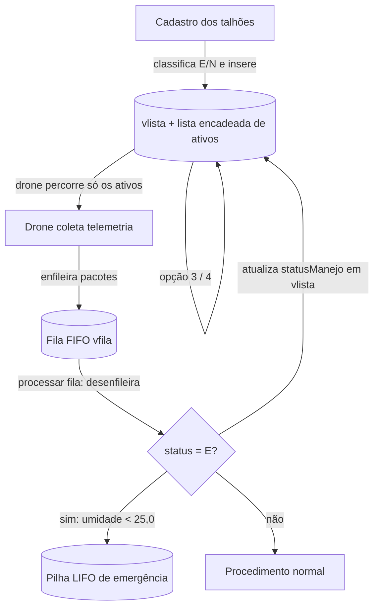

A operação do sistema segue:
 * Insira os talhoes e suas respectivas informações
 * Coletar dados de telemetria
 * Processar a fila de telemetria

 Tudo é sobre a esturutra Telemetria

A lista: Cadastro fixo dos talhões. O encadeamento via prox forma a lista de irrigação ativa.
Fila: FIFO de pacotes de telemetria coletados pelo drone
O drone percorre apenas a lista ativa, então os pivôs desativados são pulados. Para cada talhão visitado, ele cria um pacote de telemetria (cópia do registro com o status já classificado) e o coloca no final da fila.

Pilha: LIFO de emergência hídrica
Ao processar a fila, os pacotes saem na ordem de chegada (FIFO). Cada pacote atualiza o statusManejo do talhão correspondente em vlista. Com a fila vazia, os índices são reiniciados e a pilha de emergência é reconstruída: percorre-se a lista ativa e empilham-se os talhões com status "E".

Usem as flags para controlar o comportamento do codigo:
FLAG_TALHOES_VARIAVEIS: o Matheus tinha implementado que os talhoes fossem variaveis, basta ativa-la para voltar este funcionamento.
FLAG_TALHOES_OUTRAS_INFORMACOES: Adiciona as outras informações que no codigo não usamos, como cultura, e volume d'agua.
(Tem um pequeno bug com o volume ate então, deixe a flag ativa)

Você pode visualizar os dados nas funções de visualização
E pode Ativar/desativar ou modificar um talhão.

As reponsabilidades eram:
 - Registro/Menu

 - Lista
 A lista encadeada de cada talhao, caso desativo são pulados.

 - Fila
 Os drones percorrem a lista encadeada de talhoes, e preenchem a fila com a telemetria

 - Pilha
 A pilha de emergencia e criada com base nos dados da lista de telemetria:

